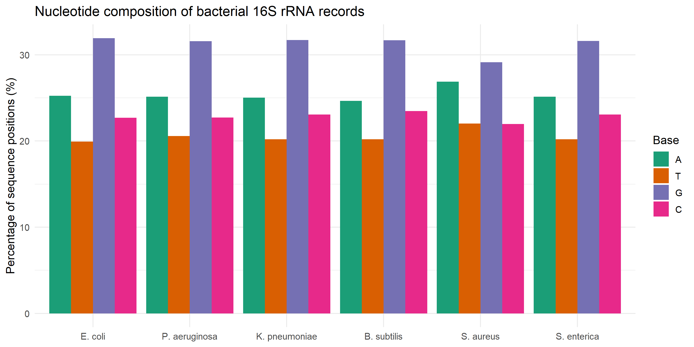
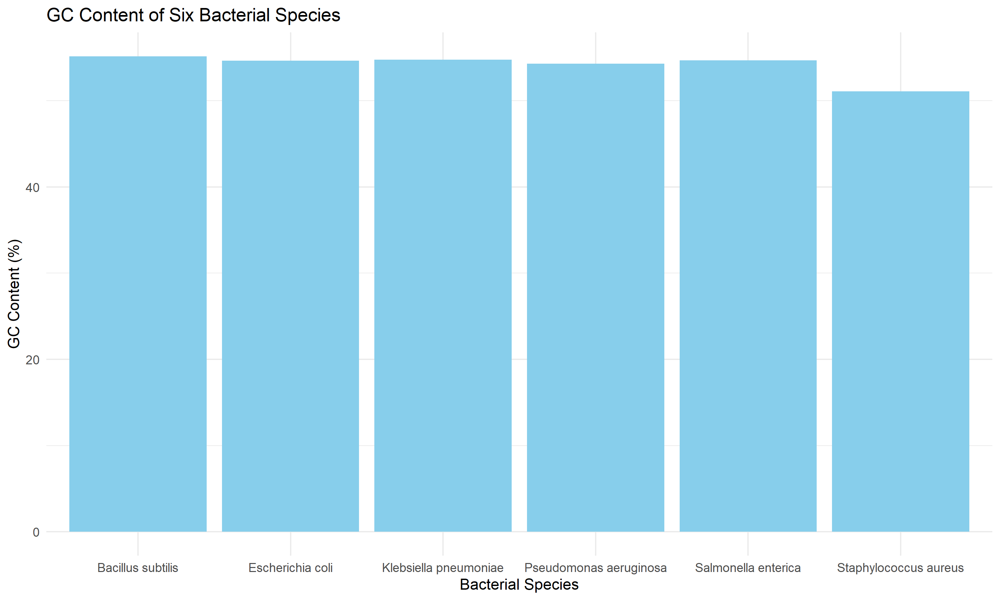
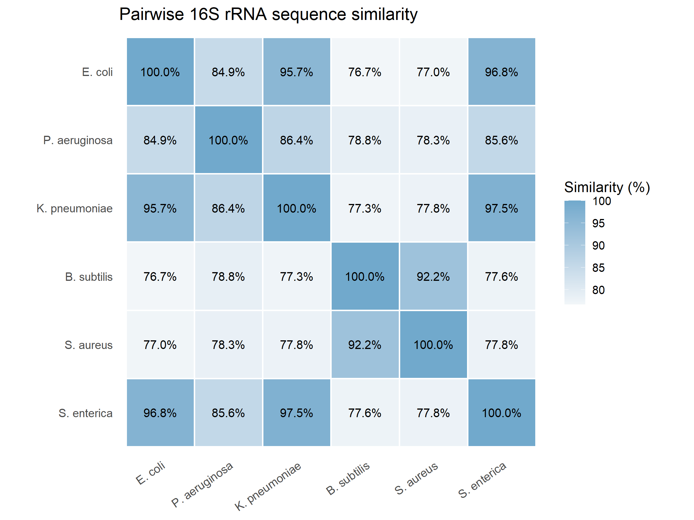
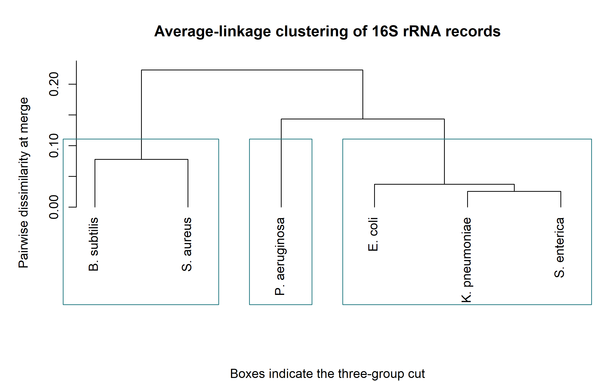

# Comparing Six Bacterial 16S rRNA Reference Sequences

## Abstract

The 16S ribosomal RNA (rRNA) gene is commonly used to compare bacterial isolates. This project examined how nucleotide composition and aligned sequence similarity describe six bacterial reference records from NCBI RefSeq. The workflow used R to check the FASTA records, calculate base frequencies and GC content, align the sequences, and group them by average-linkage hierarchical clustering. GC content ranged from 51.10% to 55.16%. The highest similarity between different records was 97.45%, observed between the selected *Klebsiella pneumoniae* and *Salmonella enterica* records. A three-group cut placed *Escherichia coli*, *K. pneumoniae*, and *S. enterica* together, paired *Bacillus subtilis* with *Staphylococcus aureus*, and left *Pseudomonas aeruginosa* on its own. The analysis illustrates how a single marker can reveal similarities among reference records and why those similarities need to be interpreted in light of sequence coverage and sampling.

## Introduction

When a bacterial 16S rRNA gene sequence is compared against a reference collection, the amount of similarity can help narrow down which organisms it resembles. The gene encodes part of the bacterial ribosome and contains regions that vary at different rates. Conserved regions help make alignment possible across different bacteria, while variation in other regions provides information that can help distinguish some taxa. Closely related bacteria can still have highly similar 16S sequences, which limits the resolution of the marker for species identification (Janda & Abbott, 2007).

Base composition gives another way to describe a sequence. GC content reports the percentage of positions containing guanine or cytosine, and a nucleotide composition plot separates that summary into the four individual bases. These measures are easy to compare, but they discard the order of the bases. An alignment uses the position of each base, allowing two sequences with similar overall composition to differ in the pattern of their substitutions.

The research question was **how do GC content and aligned 16S rRNA sequence similarity compare across six selected reference records, and what groups appear in hierarchical clustering?** The expectation was that the three selected members of the family Enterobacteriaceae, *E. coli*, *K. pneumoniae*, and *S. enterica*, would show relatively high similarity and group together. The comparison was designed as a descriptive analysis of known reference records. The six records provide a small dataset for examining what each summary contributes to a sequence comparison.

## Data

The input was a [FASTA file of six nucleotide records](data/bacterial_16S_sequences.fasta) from the NCBI Reference Sequence collection. The dataset includes one record per species. This is a purposive sample with three members of Enterobacteriaceae and three bacteria from other families, allowing the expected group to be compared with a set of more distant references. The unit of analysis was one versioned reference sequence. Each FASTA header identifies its accession, organism, strain, and whether the record is described as partial or complete.

| Species | Strain | NCBI RefSeq accession | Record coverage | Length (nt) |
| --- | --- | --- | --- | ---: |
| *Escherichia coli* | U 5/41 | [NR_024570.1](https://www.ncbi.nlm.nih.gov/nuccore/NR_024570.1) | Partial | 1,450 |
| *Pseudomonas aeruginosa* | DSM 50071 | [NR_117678.1](https://www.ncbi.nlm.nih.gov/nuccore/NR_117678.1) | Partial | 1,527 |
| *Klebsiella pneumoniae* | DSM 30104 | [NR_117686.1](https://www.ncbi.nlm.nih.gov/nuccore/NR_117686.1) | Partial | 1,530 |
| *Bacillus subtilis* | 168 | [NR_102783.2](https://www.ncbi.nlm.nih.gov/nuccore/NR_102783.2) | Complete | 1,550 |
| *Staphylococcus aureus* | S33 R | [NR_037007.2](https://www.ncbi.nlm.nih.gov/nuccore/NR_037007.2) | Complete | 1,552 |
| *Salmonella enterica* | Typhimurium LT2 | [NR_074910.1](https://www.ncbi.nlm.nih.gov/nuccore/NR_074910.1) | Partial | 1,544 |

*Table 1. The six RefSeq records analyzed, with coverage as annotated in the FASTA headers and length in nucleotides.*

The input contains public bacterial reference sequences and no patient information. NCBI states that it places no restrictions of its own on use or distribution of data in its molecular databases, while submitters may assert rights over submitted material. The versioned accession links identify the source records, and the repository copy fixes the inputs used to produce the results below. [NCBI policies and disclaimers](https://www.ncbi.nlm.nih.gov/home/about/policies/)

## Methods

### Import and quality control

The [R script](code/01_bacterial_sequence_analysis.R) reads the FASTA using Biostrings and verifies that every expected accession occurs exactly once. It orders records by accession metadata so that a change in FASTA order does not shift the species labels. Sequence text is converted to uppercase and checked against the IUPAC DNA alphabet before conversion to DNA strings. The code rejects records without any unambiguous bases. It reports sequence length, coverage annotation, counts for A, T, G, and C, and the number of positions with an ambiguous base. Ambiguous positions are retained in the alignment to preserve the input coordinates.

### Base composition and GC content

For each base, the composition plot divides the count of that base by the full sequence length and multiplies by 100. Expressing counts as percentages puts the records on a common scale despite their different lengths. GC content is calculated as 100 × (G + C) / sequence length. Ambiguous positions contribute to the denominator without being assigned to any of the four bases. Consequently, the four plotted percentages can add up to slightly less than 100%. The output table retains the raw counts so that this calculation can be checked for each record.

### Alignment, similarity, and clustering

DECIPHER's `AlignSeqs()` aligns the six DNA records in one multiple sequence alignment. The [aligned FASTA](results/aligned_sequences.fasta) retains the full original headers. The script then uses `DistanceMatrix()` with the overlap method and no evolutionary correction. It ignores terminal gaps and gap-to-letter comparisons. This prevents missing sequence ends from counting as substitutions when a partial record is compared with a longer one. Under DECIPHER's ambiguity rules an `N` can match any DNA base. The corresponding comparisons therefore provide less evidence of agreement than an exact match between two called bases. [DECIPHER reference manual](https://bioconductor.org/packages/release/bioc/manuals/DECIPHER/man/DECIPHER.pdf)

Each similarity value is 100 × (1 − distance). The heatmap presents that transformation as a percentage, and clustering uses the original dissimilarities. Average linkage merges groups using the mean of all distances between a record in one group and a record in the other. The dendrogram shows the order and height of the merges. A three-group cut provides a concise view of the stronger groupings before the final merges. It is a descriptive choice for this dataset, with no claim that three is an optimal or general classification.

## Results

### Quality control and composition

All six expected accessions passed the import checks. The three ambiguous positions were all recorded as `N` in *E. coli*. Its base counts sum to 1,447 out of 1,450 positions. The other five records contained only A, T, G, and C. The full [nucleotide analysis table](results/nucleotide_analysis.csv) gives the counts for each accession.

| Reference record | Ambiguous positions | GC content (%) |
| --- | ---: | ---: |
| *E. coli* | 3 | 54.62 |
| *P. aeruginosa* | 0 | 54.29 |
| *K. pneumoniae* | 0 | 54.77 |
| *B. subtilis* | 0 | 55.16 |
| *S. aureus* | 0 | 51.10 |
| *S. enterica* | 0 | 54.66 |

*Table 2. Ambiguous base counts and GC content by record. GC percentages use total record length and are rounded to two decimal places.*



*Figure 1. Percentages of sequence positions occupied by A, T, G, and C. Each percentage uses the corresponding record's total length.*

G was the most frequent base in every record. The *S. aureus* record had a visibly lower G percentage and higher A percentage than the other records. The A and T percentages can differ even when two records have similar GC content, because the GC summary combines two base counts into one value.



*Figure 2. GC content based on total sequence length. The value above each bar is the percentage rounded to two decimal places.*

GC content ranged from **51.10%** in *S. aureus* to **55.16%** in *B. subtilis*, a difference of about 4.07 percentage points using the unrounded values. The five records other than *S. aureus* fell between 54.29% and 55.16%. In particular, *E. coli* and *S. enterica* had GC values of 54.62% and 54.66%, respectively.

### Similarity and clustering

The multiple sequence alignment contained 1,569 columns. Across the 15 distinct comparisons, similarity ranged from **76.68%** for *E. coli* and *B. subtilis* to **97.45%** for *K. pneumoniae* and *S. enterica*. The *E. coli* record was 96.83% similar to *S. enterica* and 95.72% similar to *K. pneumoniae*. The three pairs within the expected group therefore also had the three highest values between different records in this sample. The full values are available in the [similarity matrix](results/sequence_similarity_matrix.csv) and [distance matrix](results/sequence_distance_matrix.csv).



*Figure 3. Pairwise similarities derived from uncorrected DECIPHER overlap distances. Diagonal entries are self-comparisons. Off-diagonal entries appear twice because the matrix is symmetric.*



*Figure 4. Average-linkage clustering based on pairwise dissimilarities. Boxes show the three-group cut and the vertical axis gives the dissimilarity at each merge.*

The [cluster membership table](results/bacterial_cluster_groups.csv) groups *E. coli*, *K. pneumoniae*, and *S. enterica* together. *B. subtilis* and *S. aureus* form a second group, with 92.25% pairwise similarity. *P. aeruginosa* forms a one-record group at this cut. Its highest similarity to another record was 86.36%, with *K. pneumoniae*. The group numbers in the table are identifiers assigned by the cut.

## Discussion

The three members of Enterobacteriaceae grouped together as expected, and their similarity values were higher than those of any other distinct pair in this dataset. The GC and alignment results also show why the two summaries should be read together. *B. subtilis* and *S. aureus* had the largest GC difference among the six records but grouped together in the dendrogram. *P. aeruginosa* and *S. enterica* had GC values within half a percentage point of each other but a pairwise similarity of 85.65%. GC content describes composition, while the aligned comparison uses the arrangement of bases within the marker.

In a reference-based identification setting, strong similarity can narrow a comparison to a set of plausible relatives. The three high-scoring comparisons within Enterobacteriaceae illustrate the resolution problem, since their database labels represent different genera even though each pair was above 95% under the method used here. The percentage depends on the aligned region, treatment of gaps and ambiguity, and the references included. A classification decision would need a larger set of candidate references and evidence appropriate to the identification question. This is consistent with published observations that the usefulness of 16S sequencing for identification varies among bacterial groups (Janda & Abbott, 2007).

The main limitation is sampling. One reference per species leaves within-species and within-genome variation unmeasured, and a purposive set of six records cannot establish a general identification threshold. The four partial records also mean that sequence pairs can be compared over different sets of positions. Excluding gaps avoids counting missing ends as mismatches, but it also leaves possible differences outside the shared region unmeasured. DECIPHER's treatment of the three `N` positions can slightly favor agreement for comparisons involving the *E. coli* record. The single alignment, distance settings, and linkage method produce one exploratory dendrogram. Its branch heights represent average dissimilarity at a merge, and the analysis did not estimate evolutionary times or statistical support for the branches.

## Conclusion

For these six reference records, aligned 16S rRNA similarity recovered the expected group of *E. coli*, *K. pneumoniae*, and *S. enterica*. Base composition provided a separate description of the records, with GC content varying from 51.10% to 55.16%. A follow-up could repeat the comparison across a common aligned region, exclude ambiguous columns, and include several reference records for each species. Comparing those results would show whether the observed groupings persist when coverage and sampling change.

## Reproducibility

The analysis was verified with R 4.6.2, Bioconductor 3.23, Biostrings 2.80.2, DECIPHER 3.8.1, and ggplot2 4.0.3 on Windows. Install the packages once in the R console if they are missing. Package versions available from the repositories depend on the R and Bioconductor versions in use.

```r
install.packages(c("BiocManager", "ggplot2"))
BiocManager::install(c("Biostrings", "DECIPHER"))
```

Open the RStudio project or change to the repository root in a terminal, then run the command below. The script uses the bundled FASTA, creates `results/` if needed, and regenerates the nine result files. In the RStudio console, the same script can be run with `source("code/01_bacterial_sequence_analysis.R")` from the repository root.

```sh
Rscript code/01_bacterial_sequence_analysis.R
```

### Render the R Markdown notebook

Open the [rendered HTML notebook](report/Bacterial_16S_rRNA_Analysis_Notebook.html) in a browser to view the results tables and four figures. The [R Markdown source](code/02_bacterial_sequence_notebook.Rmd) runs the same R script and builds its tables and figures from the regenerated outputs.

To rebuild the HTML, use RStudio or make Pandoc available on your system. After installing the analysis packages above, run the following in the R console from the repository root.

```r
install.packages(c("rmarkdown", "knitr"))

rmarkdown::render(
  "code/02_bacterial_sequence_notebook.Rmd",
  output_file = "Bacterial_16S_rRNA_Analysis_Notebook.html",
  output_dir = normalizePath("report")
)
```

The HTML was rendered with rmarkdown 2.32, knitr 1.52, and Pandoc 3.10. The figures are embedded in the HTML, so the file can be opened on its own.

## References

- Janda, J. M., & Abbott, S. L. (2007). 16S rRNA gene sequencing for bacterial identification in the diagnostic laboratory. *Journal of Clinical Microbiology, 45*(9), 2761–2764. [Article](https://doi.org/10.1128/JCM.01228-07)
- National Center for Biotechnology Information. (n.d.). *NCBI Reference Sequence Database*. [RefSeq](https://www.ncbi.nlm.nih.gov/refseq/). Individual records are cited by accession in the data table.
- Pagès, H., Aboyoun, P., Gentleman, R., & DebRoy, S. (n.d.). *Biostrings: Efficient manipulation of biological strings*. [Bioconductor package](https://bioconductor.org/packages/Biostrings)
- R Core Team. (2026). *R: A language and environment for statistical computing*. [R Project](https://www.r-project.org/)
- Wickham, H. (2016). *ggplot2: Elegant graphics for data analysis*. Springer. [Book](https://ggplot2-book.org/)
- Wright, E. S. (2015). DECIPHER: Harnessing local sequence context to improve protein multiple sequence alignment. *BMC Bioinformatics, 16*, 322. [Article](https://doi.org/10.1186/s12859-015-0749-z) · [Bioconductor package](https://bioconductor.org/packages/DECIPHER)
